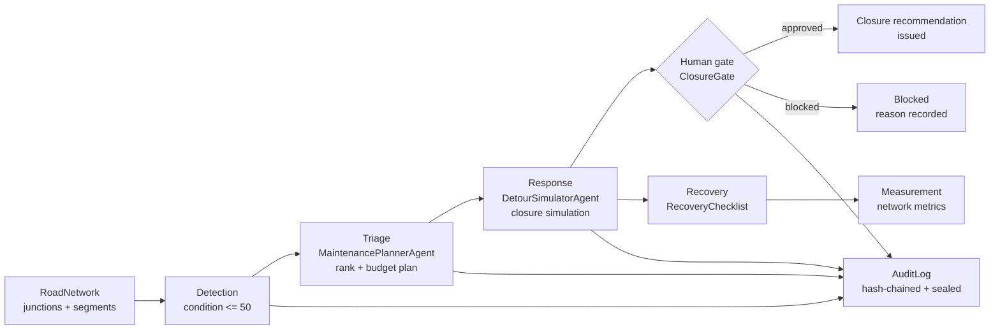
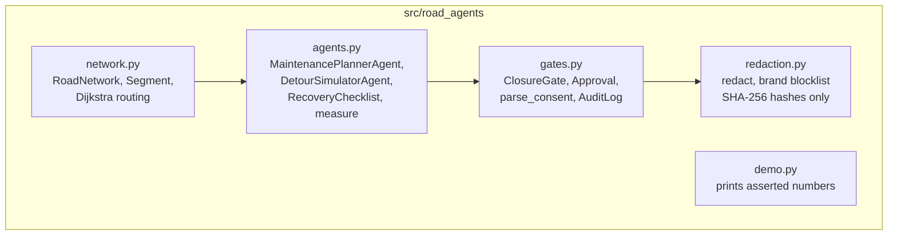

# Architecture

## Agent pipeline

## Module map

## Decisions

- **Standard library only.** No dependency can break the demo or hide a
  behaviour; every computation is readable in one file.
- **Deterministic agents, no model calls.** Ranking and rerouting are
  arithmetic and shortest-path search, so tests can assert exact numbers
  (S5 first, 37.8 added minutes for the S2 closure).
- **Gate separate from simulation.** The simulator cannot issue anything;
  only `ClosureGate.issue` with a valid `Approval` can, and the pipeline
  function never calls it. This separation is itself a test.
- **Hashes, not names, in the brand blocklist.** The repo guards against
  accidental use of real operator names without containing those names.
- **Seal over the audit log.** A plain hash chain detects edits but not
  trimming; the seal commits to count and tail hash, closing that gap.
